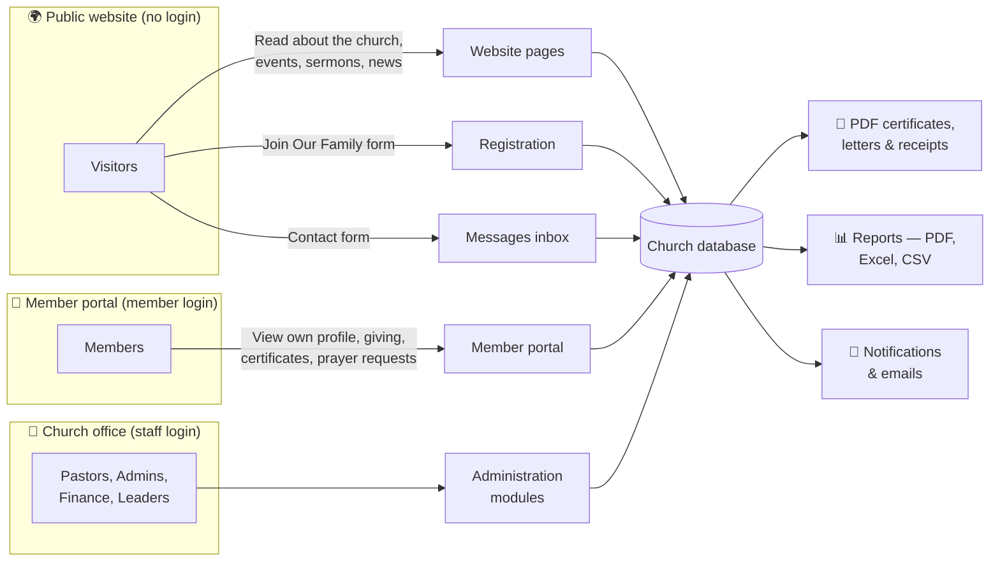
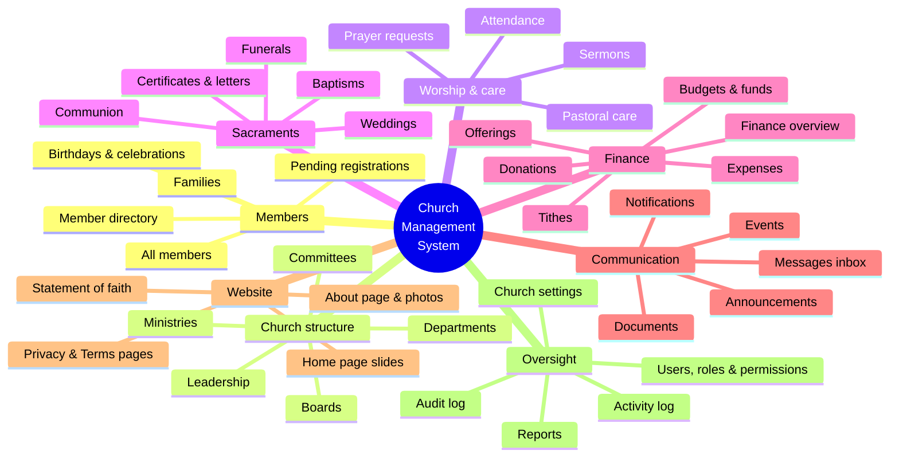
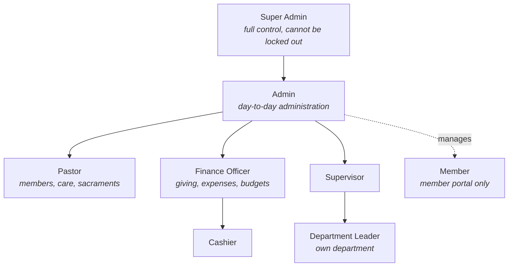
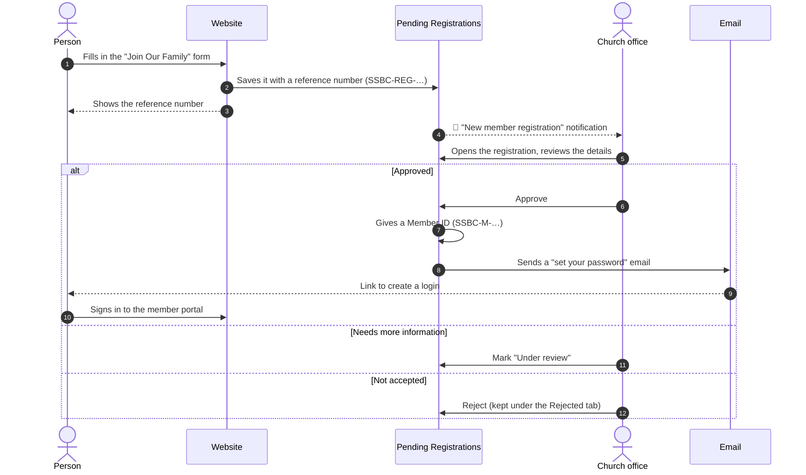
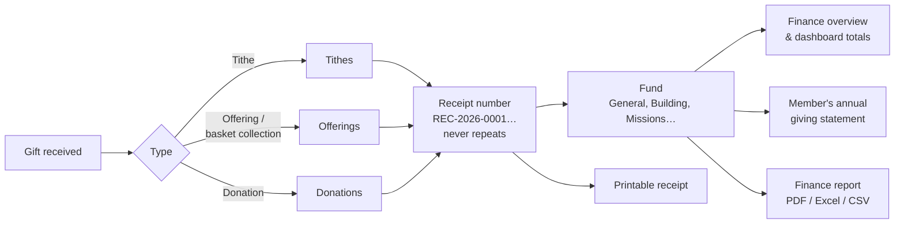
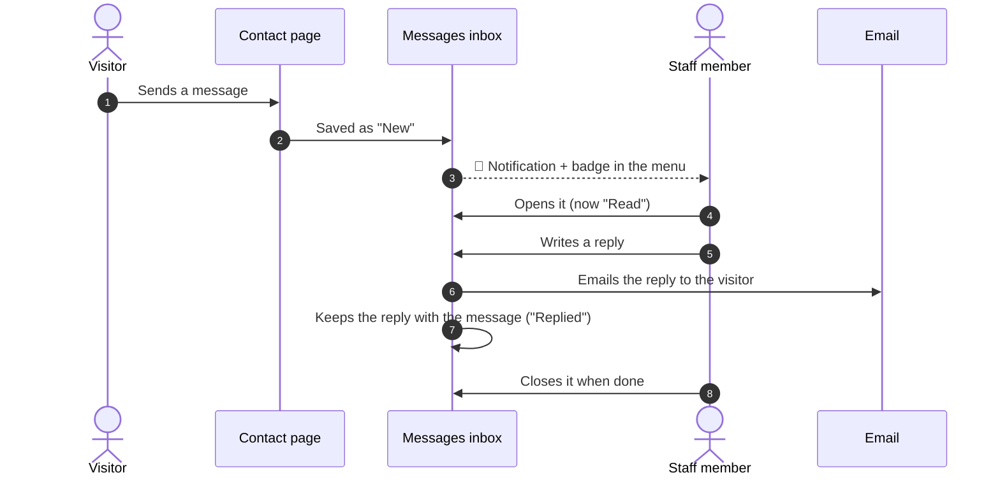
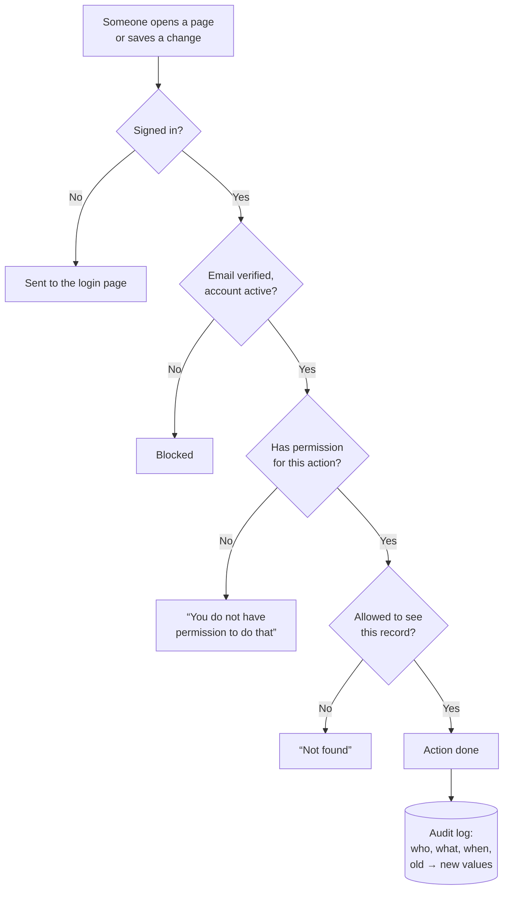

# Saint Simon Baptist Church — Church Management System

A single, secure place to run the life of the church: members and families, giving and finance, worship and attendance, sacraments and certificates, pastoral care, communication, and the public church website.

This guide explains **how the system works** for church leadership and office staff. A short technical section for the IT person who maintains the system is at the end.

---

## 1. The big picture

The system has three "doors", one for each kind of user. They all share the same secure database, so information entered once is available everywhere it is needed.



| Who          | How they get in                              | What they can do                                                                                                        |
| ------------ | -------------------------------------------- | ----------------------------------------------------------------------------------------------------------------------- |
| **Visitors** | Just open the website                        | Read about the church, see events, sermons and news, register as a member, send a message                               |
| **Members**  | Log in with the email the church has on file | See and update their own details, giving history and statements, request certificates and letters, send prayer requests |
| **Staff**    | Log in with a staff account                  | Everything their role allows — see section 3                                                                            |

---

## 2. What the system covers



---

## 3. Roles and permissions

Every staff account has a **role**, and each role has a set of **permissions** (for example "view members", "record tithes", "approve certificates"). The menu only shows what a person is allowed to use, and the system checks permission again on every action, so hiding a button is never the only protection.



- Roles and their permissions are changed under **Users → Roles** and **Permissions**. Every change is recorded in the audit log.
- An Admin cannot change or remove the Super Admin or another Admin.
- Confidential pastoral care notes are visible only to people with the special _pastoral-care confidential_ permission.

---

## 4. How a new member joins

People can register themselves on the website, or the office can add them. **Both use the same five-step form**: Personal → Church → Family → Emergency & additional → Review.



When the office adds a member directly (**Members → All Members → Add Member**), they use the same form, plus an _Office use_ box on the Church Info step for the Member ID, status, date joined, department and ministry.

---

## 5. Recording giving



- Gifts can be in **US dollars or Liberian dollars**. Each gift keeps the exchange rate of the day it was recorded, so changing the rate later never changes past totals.
- Deleting a financial record does not erase it; it is kept for the audit trail.
- Expenses go through **Pending → Approved → Paid**, and are compared with the year's **budgets**.

---

## 6. Certificates, letters and reports

All printed documents use the **church letterhead** — the logo, the church name and tagline, address and contact details, and the gold and navy rules — with a faint logo in the background. Certificates (baptism, marriage) have the church logo softly blurred behind the text.

| Document                                                                | Where to find it                                                                   |
| ----------------------------------------------------------------------- | ---------------------------------------------------------------------------------- |
| Baptism and marriage certificates                                       | **Sacraments → Certificates**                                                      |
| Recommendation, transfer and good-standing letters                      | Requested by members in the portal, approved under **Certificates**                |
| Annual giving statements                                                | Member portal, or **Certificates** for the office                                  |
| Receipts                                                                | **Finance → Finance overview → Receipts**                                          |
| Reports (membership, finance, attendance, sacraments, ministry, events) | **Reports** — view or print on letterhead, download PDF, or export to Excel or CSV |

---

## 7. Messages from the website



---

## 8. Managing the website — no programming needed

Everything on the public website is edited from the admin menu:

| What                                                                                                        | Where                                                                    |
| ----------------------------------------------------------------------------------------------------------- | ------------------------------------------------------------------------ |
| Home page slides (pictures, headings, buttons)                                                              | **Website → Hero slides**                                                |
| Statement of faith                                                                                          | **Website → Statement of faith**                                         |
| Mission, vision, story, service times, About page heading and three About photos, Contact page introduction | **Website → Text & service times**                                       |
| Privacy Policy, Terms & Conditions, Terms of Use (and any extra page)                                       | **Pages (Privacy & Terms)**                                              |
| Church name, logo, address, phone, email, currency and exchange rate                                        | **Church Settings**                                                      |
| Events, sermons, announcements, ministries, departments, leadership                                         | Their own menus; anything marked public/published appears on the website |

Each event, sermon, news item, ministry, department and leader gets its own web address based on its name — for example `/church/events/harvest-thanksgiving-service`.

Pages under **Pages** use simple formatting: leave a blank line between paragraphs, start a line with `## ` for a heading and `- ` for a bullet point. Use **Preview** before saving. Pages marked _Link in website footer_ appear at the bottom of every website page.

---

## 9. Keeping information safe



- **Passwords** are stored encrypted. Too many wrong attempts temporarily blocks sign-in, and suspicious sign-ins alert administrators.
- **Every change** to church records, roles and settings is written to the **Audit log**. Sign-ins, devices and locations are in the **Activity log**.
- **Notifications** keep the right people informed: new registrations, expenses awaiting approval, pastoral cases, prayer requests, document requests, website messages and account role changes.
- **Uploads** are checked for type and size, and private documents are only released to people allowed to see them.
- **Backups**: ask your IT person to back up the database daily (see the technical section).

---

## 10. Everyday tips

- **Pages take a moment?** A "Loading…" indicator appears whenever a page or save takes longer than a moment. Please wait for it to finish rather than clicking again.
- **The bell** at the top shows your notifications; click one to go straight to the record.
- **Search** at the top finds members by name, email or Member ID.
- **Pending Registrations** shows everyone waiting for review; the number in the menu is how many.
- **Reports** open quickly after the first time each day, because figures are remembered until something changes.

---

## Technical section (for the IT administrator)

### Requirements

PHP 8.4 with OPcache enabled, MySQL 8, Node 22, Composer 2. Built with Laravel 13, Inertia 3 and React 19.

### First-time setup

```bash
composer install
cp .env.example .env        # then set DB_*, MAIL_*, APP_URL and CHURCH_* values
php artisan key:generate
php artisan migrate
php artisan db:seed         # roles, first admin, legal pages, website text, funds (+ demo data outside production)
php artisan storage:link
npm ci && npm run build
```

### Seeders

| Seeder                                                                                     | Purpose                                               | Runs in production          |
| ------------------------------------------------------------------------------------------ | ----------------------------------------------------- | --------------------------- |
| `RolePermissionSeeder`                                                                     | Roles and permissions                                 | Yes                         |
| `AdminUserSeeder`                                                                          | First Super Admin account                             | Yes                         |
| `SitePageSeeder`                                                                           | Privacy Policy, Terms & Conditions, Terms of Use      | Yes                         |
| `WebsiteContentSeeder`                                                                     | Story, About heading, hero slides, statement of faith | Yes (fills only empty text) |
| `FinanceFundSeeder`                                                                        | General, Building, Missions, Benevolence, Youth funds | Yes                         |
| `DepartmentSeeder`, `MinistrySeeder`, `BoardSeeder`, `CommitteeSeeder`, `LeadershipSeeder` | Church structure samples                              | No                          |
| `MemberSeeder`                                                                             | 36 sample members, 6 families, memberships            | No                          |
| `EventSeeder`, `SermonSeeder`, `AnnouncementSeeder`                                        | Website and calendar samples                          | No                          |
| `GivingSeeder`, `ExpenseBudgetSeeder`                                                      | Six months of giving, expenses and budgets            | No                          |
| `PrayerRequestSeeder`, `AttendanceSeeder`                                                  | Prayer and attendance samples                         | No                          |

Load only the sample data with `php artisan db:seed --class=DemoDataSeeder`. All seeders can be run again safely; existing records are kept.

### After each update

```bash
php artisan down
# back up the database first
composer install --no-dev --optimize-autoloader
npm ci && npm run build
php artisan migrate --force
php artisan optimize:clear && php artisan optimize
php artisan permission:cache-reset
php artisan up
```

### Scheduled tasks

Add the Laravel scheduler to cron (`* * * * * php artisan schedule:run`). It sends the daily birthday notice and removes expired API tokens.

### Performance settings

- **PHP:** enable OPcache in `php.ini` (`zend_extension=opcache`, `opcache.enable=1`).
- **MySQL:** set `innodb_buffer_pool_size` (for example `1G`) in the **MySQL** configuration file — `my.ini` on Windows, `my.cnf` on Linux — under `[mysqld]`, then restart MySQL. This setting is not in `php.ini`.
- `php artisan perf:purge --force` removes load-test data created by `perf:seed` (never use `perf:seed` on a live database).

### Useful commands

```bash
php artisan members:accounts --dry-run   # check member logins
php artisan test                          # run the automated tests
php artisan perf:explain                  # check database query speed
```
